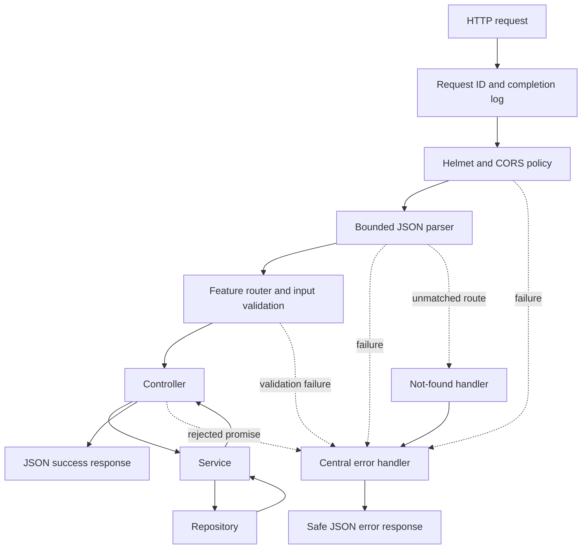

# Architecture

This is one Express application organized by feature. Start with a single process and small modules; add infrastructure when a feature requires it.

## Boundaries

| Location | Owns | Avoid |
| --- | --- | --- |
| `server.js` | Startup configuration, HTTP listener, timeouts, process shutdown | Feature business rules |
| `app.js` | Middleware order and mounting routers | Storage queries |
| `config/` | Parsing and validating environment settings | Reading environment variables throughout features |
| `features/<name>/*.routes.js` | Route definitions and wiring the feature | Business decisions |
| `*.schemas.js` | Accepted HTTP inputs and normalization | Database access |
| `*.controller.js` | Calling services and formatting HTTP responses | Direct storage access |
| `*.service.js` | Use cases and business rules | Express request/response objects |
| `*.repository.js` | Storage operations | HTTP status codes and response formatting |
| `middleware/` | Reusable HTTP behavior | Feature-specific business rules |
| `shared/` | Small helpers genuinely shared across modules | A dumping ground for unrelated functions |

The items repository owns its memory store and returns plain records or `null`. The service translates a missing record or exhausted example store into a public application error. The memory cap is checked atomically during insertion. There is one repository instance per created app. Simple factory functions wire the feature; no dependency injection framework is required.

## Request lifecycle

`/health` responds after the shared middleware without accessing the example feature. Permitted CORS preflight requests end in the CORS middleware with HTTP 204. Express also handles HEAD for GET routes with the same headers and no response body.

Validation writes parsed input to `res.locals.validated.body`, `.query`, or `.params`. This avoids changing Express 5's read-only `req.query` getter and ensures controllers use the validated values. Every asynchronous controller returns its promise to Express 5, which forwards rejections to the last error handler. No async wrapper package is needed.

## Rules for keeping the starter small

1. A feature owns its routes, schemas, controller, service, and data access. Import another feature's service rather than reaching into its repository.
2. Services accept plain values and return plain data. Controllers handle HTTP details.
3. Pass explicit validated fields to storage. Do not spread an untrusted request body into a model or query.
4. Keep startup side effects in `server.js`. Importing `app.js` should not open a port.
5. Mount security and parsing middleware before features; place not-found and error handlers last.
6. Share a helper only after a second feature needs it. Do not introduce base classes, generic repositories, or empty infrastructure folders.
7. Keep the OpenAPI document, implemented routes, and behavior checks in the same change. The document defines the intended public interface; behavior changes must update it.

## Security and operational limits

Configuration is validated once before listening. Origins are explicitly allowlisted, proxy trust is disabled by default, and JSON bodies have a size limit with compression disabled. Logs contain generated request IDs, methods, route templates, response status, and duration. They exclude raw URLs, headers, IPs, bodies, raw error messages, and stacks. Use local debugging to investigate unexpected errors; do not enable indiscriminate request logging.

Only known `AppError` messages are sent to clients. Unexpected failures get a generic 500 response. Validation errors describe fields without echoing submitted values. App responses are marked `no-store`. These defaults reduce accidental exposure; permission checks, authentication, endpoint-specific rate limits, and durable storage are project decisions that still need implementation before public use with personal data.

The example store is ephemeral, capped at 1,000 records, and local to one process. Its list endpoint limits returned rows to 100. Offset pagination is an approachable example; large datasets may need indexed queries and cursor pagination. Replace the repository implementation when adding a database and revisit concurrent writes, transactions, and pagination semantics.

On shutdown, the server stops accepting connections and gives active requests up to 10 seconds to finish. A future database/client connection should be closed in this lifecycle after requests drain. CPU-heavy work should be moved to a worker or job when a feature needs it; avoid blocking operations in request handlers.

## Where future pieces fit

Add database connection settings under `config/`, storage methods under the relevant feature, and migrations for the chosen persistence tool. Add authentication as a feature and reusable authorization checks under `middleware/`. Create an external-client or background-job module only when a use case requires it. Keep persistent state outside the HTTP process before running multiple instances.
